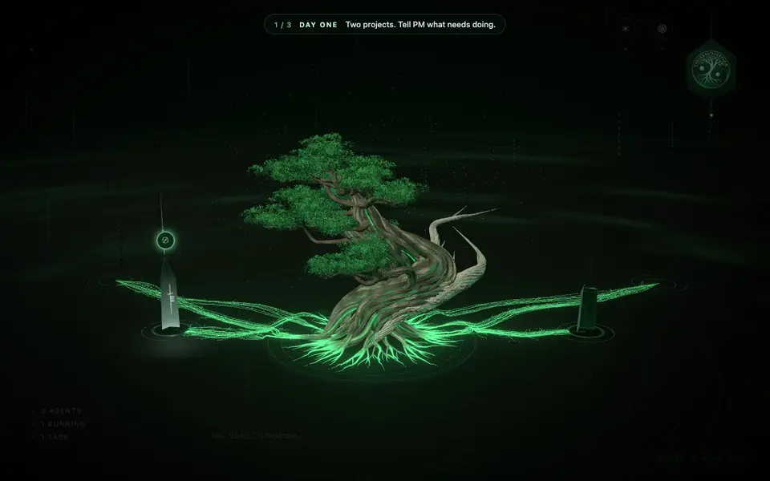
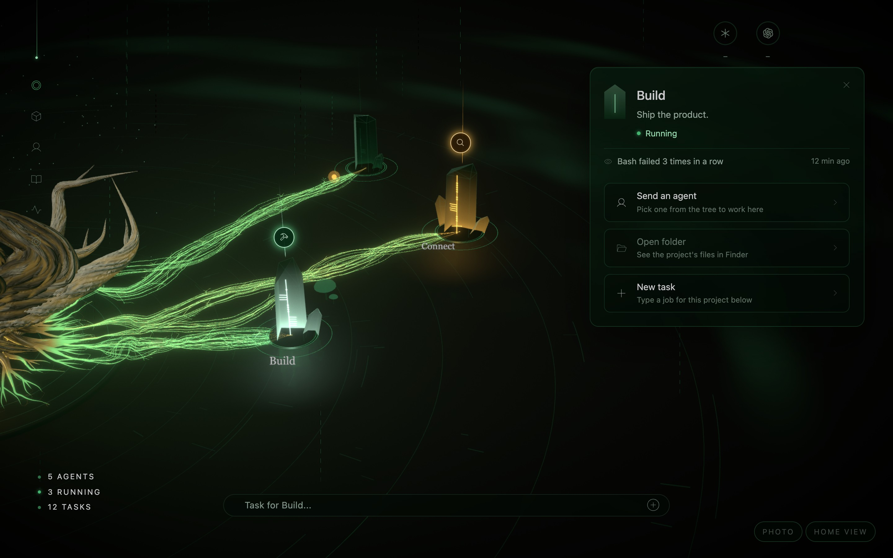
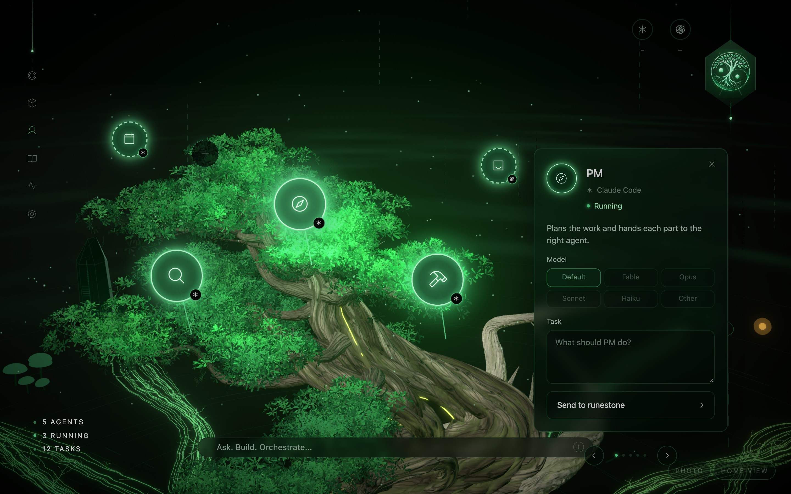

# Agentic Grove

A calm desktop cockpit for your AI agents. Your projects stand as runestones, your agents live in
a tree, and amber light means something needs you. Leave it open on a spare screen: glance over,
see what is working and what is waiting, and look away again.

It is not a chat app. Your agents still run in Claude Code and Codex; the Grove shows you all of
them at once and sends them where they are needed.

The look comes from druidic tradition: the sacred grove where druids met, a great tree at its
heart, standing stones carved with ogham-like marks, and roots joining everything underground.
The Grove keeps that feeling and gives it a quiet, sci-fi glow.



*The grove growing, in demo mode: day one, a few weeks in, and a full grove under load. A real
grove starts empty and grows a stone for each project you connect.*

**[Download for Mac](https://github.com/Adiezc/agentic-grove/releases/latest)** · Apple Silicon,
macOS 13 or newer · Needs Claude Code or Codex, signed in with your Claude or ChatGPT account ·
Free for non-commercial community use, source-available, no telemetry

**Status: early, and changing quickly.**

> **Help wanted.** The Grove is Mac-only, and its maintainer has no Windows or Linux machine. If
> you use either, or run local models with Ollama or LM Studio, there are
> [small first issues](https://github.com/Adiezc/agentic-grove/labels/good%20first%20issue)
> of an hour or two each. See [For contributors](#for-contributors).

## What you can do with it

- **See your work at a glance.** Each project is a stone. It lights while an agent works there and
  turns amber, the grove's one warning colour, when an agent is waiting for you. A git worktree
  stands beside its repository as a twin stone.
- **Tell PM what needs doing.** Type a job into the console. PM, the project manager on the tree,
  plans it, hands each part to the right agent (Researcher, Builder, or any you add), checks the
  work and reports back. Bigger jobs get a plan you approve first. It all runs in Terminal as your
  own Claude Code or Codex.
- **Or send one agent yourself.** Pick a stone and an agent, or start with its name ("@builder fix
  the tests"). You see who takes the job, on which model and where, before anything is sent.
- **Know how much you have left.** Five-hour and weekly headroom for Claude and ChatGPT, each
  figure marked official, counted or unknown.
- **Leave it open all day.** When nothing has happened for a few seconds it draws less, and hidden
  it uses almost nothing.

**And more:** choose each agent's model, save the jobs you repeat, leave a note for next time, ask
"what did I do yesterday?", move around with the arrow keys, and press P for photo mode.

| | |
| --- | --- |
|  |  |
| Choose a stone to see its state and what you can do there. | PM and its team on the tree. Send PM, or any one agent. |

## Where it runs, and what it works with

| | |
| --- | --- |
| **macOS** (Apple Silicon) | Supported. This is the only platform today. |
| **Windows** | Not yet, and **looking for contributors**: the maintainer has no Windows machine. The port is split into six issues, [#13](https://github.com/Adiezc/agentic-grove/issues/13) to [#18](https://github.com/Adiezc/agentic-grove/issues/18). |
| **Linux** | Not yet. Contributions welcome; most of the Mac code carries over. See [#19](https://github.com/Adiezc/agentic-grove/issues/19). |

The Grove works with the two AI providers most people use today: **Claude** (the Claude app,
Claude Code, Cowork) and **ChatGPT** (the ChatGPT app, Codex, Dots). Ideally you have the Claude
or ChatGPT desktop app as well as the command-line tools; if something is missing, the first-launch
walkthrough and Settings help you get it in a click or two.

Those two are a starting point, not a wall. Other providers and locally run models (Ollama, LM
Studio and the like) can be added: each tool the Grove understands is one small adapter in
`core/harnesses/`, and the contract is in its README. One for Cursor is already written but has
never been tested on real data. Contributions are welcome, and **we especially welcome work that
lets the Grove run fully offline on your own models**, including a European option such as
Mistral's open-weight models; see [CONTRIBUTING.md](CONTRIBUTING.md).

---

## Getting started

You need a Mac with Apple Silicon (M1 or later) running macOS 13 Ventura or newer, and Claude Code
or Codex signed in with your Claude or ChatGPT account. Without one of them the grove has nothing
to show; the first launch helps you install and sign in. Building it yourself also needs
[Node.js](https://nodejs.org) 22 or newer.

### Download

Builds appear under [Releases](https://github.com/Adiezc/agentic-grove/releases) as a disk image
(`Agentic-Grove-<version>-arm64.dmg`).

1. Open the disk image and drag **Agentic Grove** onto **Applications**.
2. Open it. macOS will refuse the first time, because the app is not signed with a paid Apple
   developer certificate.
3. Open **System Settings → Privacy & Security**, scroll down, and click **Open Anyway** beside
   Agentic Grove. Confirm once more. From then on it opens normally.

A newer version replaces the app the same way. Your projects, agents and settings live in
`~/.agentic-grove`, outside the app, so they are kept.

### Build it yourself

**The easy way:** if you use Claude Code or Codex, ask it:

> Install Agentic Grove for me by following https://github.com/Adiezc/agentic-grove/blob/main/INSTALL.md

**By hand:**

```bash
git clone https://github.com/Adiezc/agentic-grove.git
cd agentic-grove
npm ci
npm run app      # builds the app into ~/Applications
open ~/Applications/"Agentic Grove.app"
```

(`npm run dev` runs it in development mode instead, for working on the Grove itself.)

### First launch

PM walks you through the grove. The second card has one button, **Get ready**. It looks
for Claude Code and Codex first (including the copies inside the Claude and ChatGPT apps), and
only installs what is missing. Then it does whichever of these is still needed: install Claude
Code, sign you in (in Terminal and your browser, the one step that needs you), and turn on live
updates. If you already have everything, there is nothing to press. Settings has the same
controls, one per tool.

## What it can and cannot see

This project tries hard not to lie to you. Some things are knowable and some are not, and the
interface is built to show the difference rather than hide it.

| Tool | What the Grove can do |
| --- | --- |
| Claude Code (terminal and desktop) | **Watch and send.** Every session, live through its hooks. Sends agents by opening your own Claude Code in Terminal. Official limits when you press Check now |
| Codex | **Watch and send.** Every session, with OpenAI's own five-hour and weekly figures. Sends agents by opening your own Codex in Terminal |
| Claude Cowork | **Link only.** Everyday work in the Claude app; the Grove opens it |
| ChatGPT Dots | **Link only.** OpenAI's always-on agents; no public API yet |

"Link only" means the Grove can open it for you and nothing more, and the interface shows those
as loose fireflies rather than agents on the tree. A figure the Grove cannot know honestly is shown
as unknown rather than guessed.

Three limits worth knowing before you rely on it:

- **The Grove starts work; it does not run it.** A job you send runs in a Terminal window as your
  own Claude Code or Codex, on your own plan. The Grove watches it, and cannot stop it or answer
  for it; the Terminal window can.
- **Claude's official limits are read only when you ask.** Claude Code's token use is counted from
  its records all the time. The official five-hour and weekly percentages come from running your
  Claude Code once, when you press Check now in Settings. It is off until you switch it on.
- **History is as good as the records.** A session records when it started and when it was last
  written to. The Grove will not claim you worked on something in between.

## Privacy and the network

Everything the Grove reads stays on your Mac. It sends nothing about you, your projects or your
usage anywhere. The one network request it makes by itself is **checking for updates**: once a
day, while you are online, it asks GitHub's public releases page for the newest version number.
That request carries no identifier. It exists so you can hear about new versions, and you can turn
it off in Settings. The Grove never installs anything by itself; you download new versions when
you choose.

One more thing reaches the network, and only when you press it: **Check now** under Settings →
Claude limits runs your own Claude Code once to read your official limits. That is one small
request to Anthropic on your plan (about 600 tokens), made by Claude Code, not by the Grove. It is
off by default and never runs on a timer.

Your grove (projects, agents, settings) lives in `~/.agentic-grove/grove.json`, outside the app,
so an update never touches it. It is plain JSON and meant to be edited by hand if you like.

**How the app protects your Mac.** The window that draws the grove cannot touch your files or run
programs itself. It can only ask the app for a short list of actions, each checked before it
happens. It cannot load anything from the internet, open web pages or windows of its own, or ask
for your camera, microphone or location. The packaged app also refuses to be used as a back door
for running other code. The details, and a check that keeps them in place
(`npm run verify:security`), are in `electron/security.ts`. Found a hole? Please report it
privately, as [SECURITY.md](SECURITY.md) describes, rather than in a public issue.

## Uninstalling

Settings → Uninstall. It takes the Grove's lines out of Claude Code's settings (if you turned live
updates on), moves the app to the Trash and quits. Your grove in `~/.agentic-grove` is kept unless
you tick "Also remove my grove". Your project folders, and Claude Code and Codex themselves, are
never touched, and everything removed goes to the Trash.

## Credits and acknowledgements

With thanks to the people whose open-source work helped this grove grow:

- **[bot-crossing](https://github.com/Station-Sciences/bot-crossing), by Jarren Rocks** — the
  original inspiration and the source of the Claude Code, Codex and Cursor adapters and scan
  helpers, adapted to TypeScript with the original MIT notice preserved.
- **[React](https://github.com/facebook/react) and its contributors** — the interface.
- **[Three.js](https://github.com/mrdoob/three.js) and its contributors** — the living scene.
- **[Poimandres](https://github.com/pmndrs) and contributors to React Three Fiber, drei,
  React Three Postprocessing, maath and Zustand** — the scene's React integration, supporting
  geometry, effects and state.
- **[postprocessing](https://github.com/pmndrs/postprocessing) and
  [n8ao](https://github.com/N8python/n8ao)** — scene effects and ambient occlusion.
- **[Phosphor Icons](https://github.com/phosphor-icons/react) and
  [Geist](https://github.com/vercel/geist-font)** — the icons and locally bundled interface font.
- **[Uncial Antiqua](https://fonts.google.com/specimen/Uncial+Antiqua) by Astigmatic** — the
  font of the stone names.
- **[Electron](https://github.com/electron/electron) and its contributors** — the desktop
  runtime, with thanks also to the maintainers of the supporting bundled libraries and build tools.

We also thank **[Claude HUD](https://github.com/jarrodwatts/claude-hud)** for the tool, worker and
todo readout ideas behind selected-panel activity details, and
**[Claude-Code-Agent-Monitor](https://github.com/hoangsonww/Claude-Code-Agent-Monitor)**,
**[clodfarm](https://github.com/matank001/clodfarm)**,
**[Odysseus](https://github.com/odysseus-dev/odysseus)** and
**[Claude-Code-Usage-Monitor](https://github.com/Maciek-roboblog/Claude-Code-Usage-Monitor)**
for specific ideas explained in [CREDITS.md](CREDITS.md). Those credits describe design influences;
their code was not copied into Grove.

**Settings → Credits and acknowledgements** has a scrollable reader for the full human credits
and bundled licence notices. They are also available from the native **Agentic Grove → About
Agentic Grove** menu. [CREDITS.md](CREDITS.md) describes what was used and changed;
[the attribution ledger](attribution.json) and [notice records](licenses/README.md) explain exact
versions and upstream notice gaps. The packaged app preserves the original notices, including
the font and Electron/Chromium. Research candidates are credited when actually adopted.

## For contributors

**Start here.** Each of these is an issue with the files to open, what done looks like and a
rough time. Comment on one to take it, so two people don't build the same thing.

| Issue | Time | Needs |
| --- | --- | --- |
| [#13 Run the checks on a Windows runner in CI](https://github.com/Adiezc/agentic-grove/issues/13) · good first issue | 1 to 2 hours | Nothing but GitHub |
| [#14 Find Claude Code sessions on Windows](https://github.com/Adiezc/agentic-grove/issues/14) · good first issue | 1 to 2 hours | Windows, the Claude app |
| [#17 The hook command without a Unix shell](https://github.com/Adiezc/agentic-grove/issues/17) · good first issue | 1 to 2 hours | Windows, Claude Code |
| [#20 Detect a running Ollama or LM Studio](https://github.com/Adiezc/agentic-grove/issues/20) · good first issue | 2 hours | A Mac with Ollama or LM Studio |
| [#15 Find `claude` and `codex` on Windows](https://github.com/Adiezc/agentic-grove/issues/15) | 2 hours | Windows |
| [#18 A Windows installer](https://github.com/Adiezc/agentic-grove/issues/18) | 2 to 3 hours | Windows |
| [#16 Start agents in Windows Terminal](https://github.com/Adiezc/agentic-grove/issues/16) | 3 to 5 hours | Windows; agree the approach first |
| [#19 A Linux version](https://github.com/Adiezc/agentic-grove/issues/19) | Half a day to a day | Linux with a desktop |

**Questions, or an idea that isn't an issue yet?** Ask in
[Discussions](https://github.com/Adiezc/agentic-grove/discussions).

[CONTRIBUTING.md](CONTRIBUTING.md) has the commands for running and building the Grove, the checks
every change should pass, and the bigger pieces: the full Windows port, and **running the Grove
offline on local models**, for people who want everything on their own machine.

**Everyone whose work is merged is named** in the release notes and in a contributors list here.

**Other features open to anyone who wants one**, each described in CONTRIBUTING.md with the
files to start from:

- Runs that always end in a word to you, even when Terminal closes mid-job
- A second try on a stronger model when a run shows signs of struggling
- A look before PM hands work that read the web to an agent that changes files
- An adapter for [opencode](https://github.com/anomalyco/opencode)
- A one-page threat model, a short map of how each part works, and a landing page

Several came from reading [Odysseus](https://github.com/odysseus-dev/odysseus) by PewDiePie
(ideas only; see [CREDITS.md](CREDITS.md)).

## Principles

1. **Read-only towards other people's tools.** The Grove never writes to another tool's session
   or transcript data. It may write to another tool's *config* — installing Claude Code hooks,
   for instance — only with your explicit consent, showing the exact change, and reversibly.
2. **Never invent a number.** Unknown is a valid and honest state. Every figure carries its
   provenance: official, measured, estimate or unknown.
3. **Minimal text.** If it can be a light, a colour or a movement, it should not be a word.
4. **Calm by default.** It is on screen all day. Nothing pulls the eye unless it has earned it.
5. **Credit generously.** This exists because other people published their work. See
   [CREDITS.md](CREDITS.md).

## Documents

- [CONTRIBUTING.md](CONTRIBUTING.md) — how to help, starting with the Windows port
- [Good first issues](https://github.com/Adiezc/agentic-grove/labels/good%20first%20issue) — small jobs of an hour or two
- [SECURITY.md](SECURITY.md) — how to report a security problem privately
- [CREDITS.md](CREDITS.md) — every project this borrows from, what was taken, under which licence
- [DECISIONS.md](DECISIONS.md) — append-only log of architectural decisions and why
- [ROADMAP.md](ROADMAP.md) — the build plan, and ranked ideas for future sessions
- `core/harnesses/README.md` — the adapter contract, if you want to add support for another tool

## Licence

Required Notice: Copyright (c) 2026 Adrian Diez Cuadrado.

Agentic Grove is source-available under [PolyForm Noncommercial 1.0.0](LICENSE),
effective for copies offered under these terms from 15 October 2026.

Non-commercial use, modification and sharing are permitted, including non-commercial work on
open-source community projects. The licence also expressly permits use by charitable
organisations, educational institutions, public research organisations, public safety or
health organisations, environmental protection organisations and government institutions,
regardless of their funding sources or funding obligations.

Commercial uses outside the licence's permitted purposes require a separate written licence
from Adrian Diez Cuadrado. Contact the maintainer through
[the project repository](https://github.com/Adiezc/agentic-grove). Publishing a project's source
code does not, by itself, make an activity non-commercial.

Preserve the licence and required notices when sharing. PolyForm Noncommercial does not
require publication of modifications. It is a source-available licence, not an OSI-approved
open-source licence. The standard [licence text](LICENSE) controls the permissions above.

Copies previously released under MIT, AGPL or other terms retain their original permissions.
Third-party code, libraries and assets retain their own licences and notices; see [CREDITS.md](CREDITS.md).
Contributors retain their copyright; see [CONTRIBUTING.md](CONTRIBUTING.md#licence-for-contributions).
